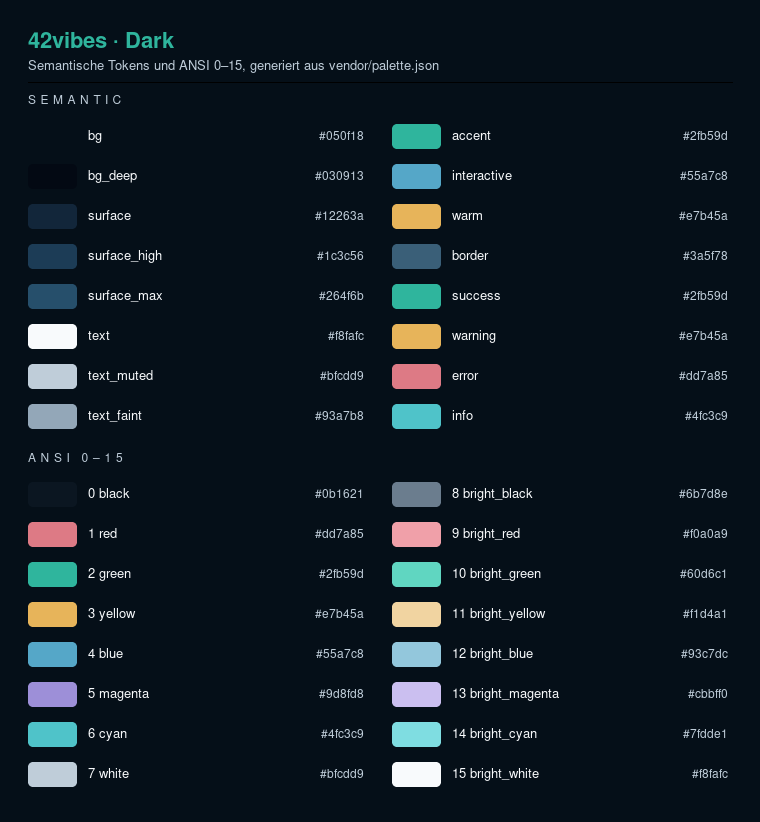

# 42vibes

[English](README.md) · **Deutsch**

Eine Dark/Light-Farbwelt für Werkzeuge, die sonst von anderen gestaltet werden:
tiefes Nachtblau, Petrol als Akzent, gedecktes Blau als zweite Stimme und
warmes Gold als Gegenpol.



## Projekte

| Projekt | Inhalt |
| --- | --- |
| [42vibes-palette](https://github.com/42vibes/42vibes-palette) | Gemeinsame Palette: semantische Tokens, 16 ANSI-Slots, generierte Vorschauen, Validator |
| [42vibes-terminal](https://github.com/42vibes/42vibes-terminal) | Profile für Kitty, Alacritty, WezTerm, Ghostty, foot, tmux, GNOME Terminal, xfce4-terminal |
| [42vibes-vim](https://github.com/42vibes/42vibes-vim) | Vim-8/9-Colorscheme mit Truecolor und 256-Farben-Fallback |
| [42vibes-bash](https://github.com/42vibes/42vibes-bash) | Starship, dircolors/LSCOLORS, bat und delta |
| [42vibes-opencode](https://github.com/42vibes/42vibes-opencode) | OpenCode-V2-Theme |
| [42vibes-vscode](https://github.com/42vibes/42vibes-vscode) | Theme-Extension für VS Code und VSCodium |
| [42vibes-firefox](https://github.com/42vibes/42vibes-firefox) | Firefox-Theme, dunkel und hell |
| [42vibes-chrome](https://github.com/42vibes/42vibes-chrome) | Chrome-/Chromium-Theme, dunkel und hell |
| [42vibes-stack](https://github.com/42vibes/42vibes-stack) | Installer, der die Palette in alle Tools bringt |

## Installation

```sh
git clone https://github.com/42vibes/42vibes-stack.git
cd 42vibes-stack
./install-all.sh --dry-run
./install-all.sh --all --yes
```

Der Installer schreibt nur mit zeitgestempelten Backups, ist idempotent und
fasst nichts außerhalb des Home-Verzeichnisses an. Die Palette bleibt die eine
Wahrheit: Jedes Projekt vendiert `palette.json` und erzeugt seine Artefakte
daraus.

## Palette

| Rolle | Dunkel | Hell |
| --- | --- | --- |
| Hintergrund | `#050f18` | `#f7fafc` |
| Fläche | `#12263a` | `#e6eef5` |
| Text | `#f8fafc` | `#08141f` |
| Gedämpft | `#bfcdd9` | `#3f5262` |
| Akzent (Petrol) | `#2fb59d` | `#177a69` |
| Sekundär (Blau) | `#55a7c8` | `#2f7191` |
| Warm (Gold) | `#e7b45a` | `#a9761f` |
| Rahmen | `#3a5f78` | `#a8bfd1` |

## Lizenz

MIT, siehe [LICENSE](LICENSE). Copyright 2026 42vibes.
