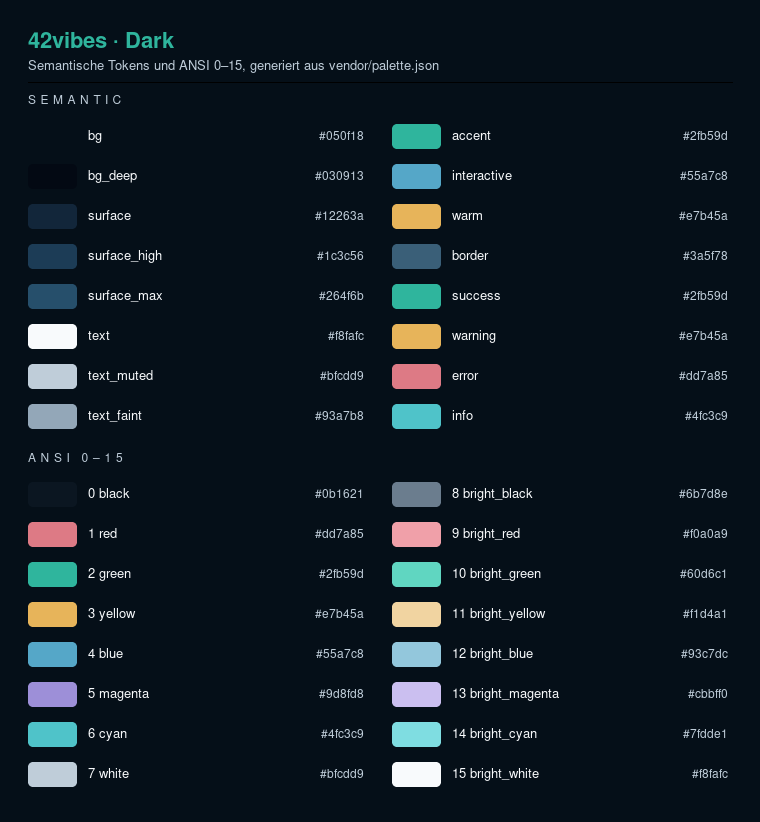

# 42vibes

**English** · [Deutsch](README.de.md)

A dark/light color world for tools that are otherwise styled by someone else:
deep navy, teal as the accent, muted blue as the second voice, warm gold as the
counterweight.



## Projects

| Project | What it is |
| --- | --- |
| [42vibes-palette](https://github.com/42vibes/42vibes-palette) | Shared palette: semantic tokens, 16 ANSI slots, generated previews, validator |
| [42vibes-terminal](https://github.com/42vibes/42vibes-terminal) | Profiles for Kitty, Alacritty, WezTerm, Ghostty, foot, tmux, GNOME Terminal, xfce4-terminal |
| [42vibes-vim](https://github.com/42vibes/42vibes-vim) | Vim 8/9 colorscheme with truecolor and 256-color fallback |
| [42vibes-bash](https://github.com/42vibes/42vibes-bash) | Starship, dircolors/LSCOLORS, bat and delta profiles |
| [42vibes-opencode](https://github.com/42vibes/42vibes-opencode) | OpenCode V2 theme |
| [42vibes-vscode](https://github.com/42vibes/42vibes-vscode) | VS Code / VSCodium theme extension |
| [42vibes-firefox](https://github.com/42vibes/42vibes-firefox) | Firefox theme, dark and light |
| [42vibes-chrome](https://github.com/42vibes/42vibes-chrome) | Chrome/Chromium theme, dark and light |
| [42vibes-stack](https://github.com/42vibes/42vibes-stack) | Installer that applies the palette across tools |

## Install

```sh
git clone https://github.com/42vibes/42vibes-stack.git
cd 42vibes-stack
./install-all.sh --dry-run
./install-all.sh --all --yes
```

The installer writes only with timestamped backups, is idempotent, and refuses
to touch anything outside your home directory. The palette stays the single
source of truth: every project vendors `palette.json` and regenerates its
artifacts from it.

## Palette

| Role | Dark | Light |
| --- | --- | --- |
| Background | `#050f18` | `#f7fafc` |
| Surface | `#12263a` | `#e6eef5` |
| Text | `#f8fafc` | `#08141f` |
| Muted | `#bfcdd9` | `#3f5262` |
| Accent (teal) | `#2fb59d` | `#177a69` |
| Secondary (blue) | `#55a7c8` | `#2f7191` |
| Warm (gold) | `#e7b45a` | `#a9761f` |
| Border | `#3a5f78` | `#a8bfd1` |

## License

MIT, see [LICENSE](LICENSE). Copyright 2026 42vibes.
